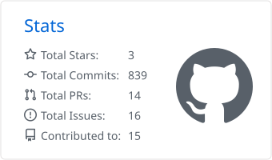

Full-Stack AI Engineer · 3+ years in fintech & AI · Software Engineer @ **Gracie Point**

---

### 👨‍💻 Experience

- **Gracie Point**: Software Engineer · *2026 – now*
- **dualmint**: Full Stack Engineer · *2025 – 2026*
- **FINT**: Frontend Intern → Senior Software Engineer · *2022 – 2025*

### 🏆 Achievements

- 🌏 **Crypto.com APAC Hackathon**: World Finalist, Top 5 of 700+ teams
- 🏅 **DevCreate**: Finalist, Top 6 of 150+ teams
- 🥇 **Sudohacks**: Winner, 60+ teams
- 🥈 **Codewars**: 1st Runner-up, 70+ teams

### 📊 Stats

<picture>
  <source media="(prefers-color-scheme: dark)" srcset="./profile-summary-card-output/github_dark/3-stats.svg" />
  
</picture>
<picture>
  <source media="(prefers-color-scheme: dark)" srcset="https://streak-stats.demolab.com?user=geeky-sambhav&theme=tokyonight&hide_border=true" />
  
</picture>

  

<picture>
  <source media="(prefers-color-scheme: dark)" srcset="https://raw.githubusercontent.com/geeky-sambhav/geeky-sambhav/output/github-contribution-grid-snake-dark.svg" />
  
</picture>

